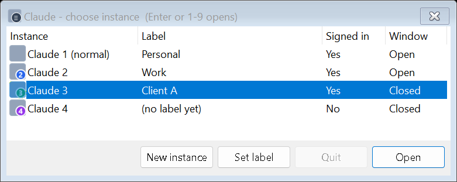

# Claude Desktop Multi-Instance for Windows

**Run two or more Claude Desktop windows at the same time on Windows, each signed in to a different Claude
account**, for example work and personal. Each copy has its own sign-in, settings and MCP servers. It also gets a
numbered desktop shortcut and a window title such as "Claude 2 - Work", so you always know which account you are
typing into.

The whole tool is one PowerShell script. It needs no admin rights, no installer and no other downloads. It is an
unofficial community tool, not made or endorsed by Anthropic.

[](https://github.com/ahsanilya-s/claude-desktop-multi-instance/actions/workflows/ci.yml)
[](https://github.com/ahsanilya-s/claude-desktop-multi-instance/releases/latest)
[](LICENSE)



<sub>The picker, with sample labels. The icons in this picture are placeholders. On your PC the tool adds a number
badge to your installed Claude icon.</sub>

## Quick start

You need Windows 10 or 11, with [Claude Desktop](https://claude.ai/download) installed for your Windows account.
Open **PowerShell** (no admin needed) and paste:

```powershell
$dir = "$env:USERPROFILE\ClaudeInstances"
$zip = "$env:TEMP\claude-desktop-multi-instance.zip"
Invoke-WebRequest -UseBasicParsing https://github.com/ahsanilya-s/claude-desktop-multi-instance/releases/latest/download/claude-desktop-multi-instance.zip -OutFile $zip
Expand-Archive $zip $dir -Force
Unblock-File "$dir\Open-ClaudeInstance.ps1"
powershell -NoProfile -ExecutionPolicy Bypass -File "$dir\Open-ClaudeInstance.ps1" -Setup
```

You should see:

```text
Desktop shortcuts ready: Claude 2, Claude - choose instance.
```

Then:

1. Double-click **Claude 2** on your desktop. A second Claude window opens.
2. **Sign in with your email address**, and type the code from the email into the Claude 2 window. If the first
   sign-in button opens your web browser, pick the email option instead; it may be under "Sign in another way".
   Google and browser sign-in hand the result back to your normal Claude, which is a
   [known Claude Desktop limitation](https://github.com/anthropics/claude-code/issues/98549).
3. Open **Claude - choose instance** on your desktop whenever you want the list of all your instances.

If you would rather look first, download the zip from the
[latest release](https://github.com/ahsanilya-s/claude-desktop-multi-instance/releases/latest). You can check it
against `SHA256SUMS.txt` and read the script, which is a single file. Then run only the last line above. To
**update**, paste the same commands again: your instances, labels and sign-ins are kept.

## What you get

- **Separate accounts side by side.** Each instance is the real Claude Desktop app with its own data folder. Sign-in,
  settings and MCP servers (`claude_desktop_config.json`) are separate, and each instance shows the chats of the
  account signed in there.
- **Easy to tell apart.** Shortcuts have numbered icons (Claude 2, Claude 3, …), you can add labels like "Work", and
  window titles such as "Claude 2 - Work" show in Alt+Tab and taskbar previews.
- **A quick picker.**
  - Press 1-9 to open an instance.
  - See which instances are signed in and open.
  - Add new instances and set labels.
- **A real Quit.** The window's X only hides Claude in the tray, where it keeps using memory. Quit closes an extra
  instance properly.
- **Your normal Claude stays as it is.** The tool never changes, moves or quits it.
- **Light.** There is no background service. A helper of about 2 MB runs only while an extra instance is open.

## Who it is for

- People with a work account and a personal account who want both open at once. A common case is an employer's Team
  or Enterprise seat plus a personal Pro or Max plan.
- Consultants and developers who keep a separate Claude setup per client or project: account, MCP servers and
  connectors.

Claude Desktop runs one account per Windows user. Anthropic's help center describes switching between accounts with
different email addresses as
[logging out and back in](https://support.claude.com/en/articles/13189465-log-in-to-your-claude-account).
Multi-account support is a long-standing request:
[anthropics/claude-code#18435](https://github.com/anthropics/claude-code/issues/18435). This tool fills the gap
until there is an official option.

## Everyday use

| To | Do this |
| --- | --- |
| Open Claude 2 | Double-click **Claude 2** on the desktop |
| See all instances | Double-click **Claude - choose instance**, then press the instance's number |
| Add Claude 3, 4, … | Picker → **New instance** |
| Name an instance | Picker → **Set label**. The shortcut and window title change within seconds |
| Close an instance completely | Picker → select it → **Quit** |
| Open your normal Claude | From the Start menu as usual, or picker → Claude 1 |

Picker keys:

- **1-9** open that number.
- **Enter** opens the selected row.
- **Esc** closes the picker.

### Command line

Every command starts with
`powershell -NoProfile -ExecutionPolicy Bypass -File "$env:USERPROFILE\ClaudeInstances\Open-ClaudeInstance.ps1"`,
followed by one of these options:

| Options | What it does |
| --- | --- |
| *(none)* or `-Name Instance2` | Opens Claude 2, and creates it on first use |
| `-Name Instance3` | Opens Claude 3. Any name of letters, digits and dashes works, for example `-Name Work` |
| `-Name Instance2 -Label Work` | Sets the label without opening it. `-Label ''` removes it |
| `-Name Instance2 -Quit` | Quits Claude 2 properly. Never touches your normal Claude |
| `-Picker` | Shows the picker |
| `-List` | Prints every instance with its sign-in state, window state and data folder |
| `-Setup` | Rebuilds the icons and desktop shortcuts. Run it again after moving the folder |
| `-Version` | Prints the version |

Built-in help: `Get-Help "$env:USERPROFILE\ClaudeInstances\Open-ClaudeInstance.ps1" -Full`

Example `-List` output:

```text
No Name            Label SignedIn  Open Folder
-- ----            ----- --------  ---- ------
 1 (normal Claude) Main      True  True C:\Users\you\AppData\Local\Claude-Data\claude_pzs8sxrjxfjjc
 2 Instance2       Work      True False C:\Users\you\AppData\Roaming\Claude-Instance2
```

## How it works

Claude Desktop is an Electron app. Electron and Chromium accept a `--user-data-dir` switch, and the app's "only one
copy at a time" lock belongs to that data folder. A copy started with a different folder therefore runs alongside
your normal Claude. The script:

1. Finds the installed Claude Desktop: the current MSIX version from claude.ai or the Microsoft Store, or the older
   per-user installer.
2. Starts it with `--user-data-dir="%APPDATA%\Claude-<Name>"`.
3. Waits for the window, then starts a tiny title helper. The helper renames "Claude" to "Claude 2 - Work" and exits
   when that instance exits.
4. Makes desktop shortcuts that run the script hidden with Windows PowerShell.

| Where | What it writes |
| --- | --- |
| The folder you installed to | `instances.json` (numbers and labels), `icons\`, `titles\`, `claude-256.png` (a copy of your installed Claude icon) and `bin\ClaudeTitleKeeper-v1.exe`. The helper exe is compiled on your PC from C# source inside the script |
| `%APPDATA%\Claude-<Name>` | The instance's own Claude data: sign-in, settings, MCP configuration, cache |
| `%LOCALAPPDATA%\Claude-<Name>\logs` | Claude's own logs for that instance |
| Desktop | One `Claude N - Label.lnk` per instance, plus `Claude - choose instance.lnk` |

The tool makes no network requests and needs no admin rights. [SECURITY.md](SECURITY.md) lists exactly what it reads
and writes.

## Requirements and what has been tested

| Setup | Status |
| --- | --- |
| Windows 11 Pro 64-bit (build 26300), Claude Desktop 4.23118.0 (MSIX from claude.ai), Windows PowerShell 5.1 | Tested by hand in November 2026: open, sign-in with an email code, labels, window titles, picker, Quit |
| Windows Server 2022 and 2025 on GitHub Actions | Automated tests on every change: settings, icons, shortcuts, the title helper, and the picker's keys and buttons (built off-screen) |
| Windows 10 | Expected to work, not tested yet |
| The older Claude installer (`%LOCALAPPDATA%\AnthropicClaude`) | Detected by the script, not tested yet |
| Windows on Arm | Not tested |
| PowerShell 7 (`pwsh`) | Not supported: the script stops with a message. Use Windows PowerShell (`powershell.exe`); the shortcuts already do |
| macOS and Linux | Not supported. See [Alternatives](#alternatives) |

## Limitations

- **It is unofficial.** A Claude Desktop update can change how the app starts. One 2026 Microsoft Store build
  ignored `--user-data-dir` ([#103068](https://github.com/anthropics/claude-code/issues/103068)); the current
  version works again. If an update breaks this tool, please open an issue.
- **Sign-in in extra instances needs an email code.** Google and browser sign-in finish in your normal Claude
  ([#98549](https://github.com/anthropics/claude-code/issues/98549)).
- **Self-updates can restart an instance as your normal profile.** This has been reported when Claude restarts itself
  after an update ([#104138](https://github.com/anthropics/claude-code/issues/104138)). If Claude 2 suddenly shows your
  main account, close that window and open Claude 2 from its shortcut.
- **Memory.** Each open instance is a full Claude Desktop, around 1 GB on the maintainer's PC. Quit instances you are
  not using; the X only hides them.
- **Taskbar.** Extra instances keep Claude's normal taskbar icon and may be grouped with it. The number shows in the
  window title and on the desktop shortcut.
- **The "Signed in" column is a best guess** from the instance's settings file.
- **Work PCs.** If your organization manages Claude Desktop on your PC, for example by blocking personal accounts,
  follow its rules.
- **Moving the folder** breaks the shortcuts until you run `-Setup` again.

## Troubleshooting

- **Claude 2 opened with my normal account.** It was started without its own data folder, for example after an
  automatic update. Close it, then open Claude 2 from its shortcut.
- **Claude 2 shows a blank white window.** Quit it in the picker and open it again. On the maintainer's PC this
  happened after Claude 2 had been hidden in the tray for a long time while memory was low.
- **The window title stays "Claude".** The helper starts as soon as the window exists, which can take up to 30 seconds.
  Check that `bin\ClaudeTitleKeeper-v1.exe` exists and that antivirus did not block it. It is compiled on your PC, so
  it is unsigned.
- **"Claude Desktop is not installed for this Windows account."** Install Claude Desktop from
  [claude.ai/download](https://claude.ai/download) while signed in to Windows as yourself.
- **"Running scripts is disabled on this system."** Use the full `powershell -NoProfile -ExecutionPolicy Bypass
  -File …` command, or the shortcuts. This allows this one script without changing your system policy.
- **The download fails with "Could not create SSL/TLS secure channel"** (older Windows 10). Run
  `[Net.ServicePointManager]::SecurityProtocol = 'Tls12'` first.

There are more answers on the [FAQ and troubleshooting page](https://ahsanilya-s.github.io/claude-desktop-multi-instance/faq.html).

## FAQ

**Is this made by Anthropic?**
No. It is an independent open-source script that starts the official app you already have.

**Does it modify Claude Desktop?**
No. It does not patch, inject into or copy the app. It starts the installed app with a standard Chromium switch, and
renames the extra windows' titles.

**Does it get around usage limits?**
No. Each instance uses the account you sign in with, under that account's limits. Anthropic's
[Consumer Terms](https://www.anthropic.com/legal/consumer-terms) forbid sharing an account. Its
[Usage Policy](https://www.anthropic.com/legal/aup) forbids using extra accounts to evade bans or detection, and
reselling access. Use this tool only for accounts that are yours.

**Can two instances use the same account?**
Yes, just as you can use Claude on two devices. This is handy if you want two different MCP server setups.

**How do I remove one instance?**
1. Quit it.
2. Delete its desktop shortcut.
3. Delete `%APPDATA%\Claude-<Name>` and `%LOCALAPPDATA%\Claude-<Name>`.
4. Remove its entry from `instances.json`.

A `-Remove` command is on the roadmap.

## Uninstall

1. In the picker, Quit each extra instance.
2. Delete the desktop shortcuts "Claude 2 …" and "Claude - choose instance".
3. Delete the folder `%USERPROFILE%\ClaudeInstances`.
4. Optional: delete the extra instances' local data. For each instance, delete `%APPDATA%\Claude-<Name>` and
   `%LOCALAPPDATA%\Claude-<Name>`. You will be signed out in those instances; your chats stay in your Claude
   account.

## Alternatives

Other community projects solve the same problem. They are listed for convenience, not reviewed or endorsed, with
details as of November 2026:

- **Windows:**
  - [vodongha/claude-desktop-clone](https://github.com/vodongha/claude-desktop-clone)
  - [Zoltak-Dev/ai-multi-instance](https://github.com/Zoltak-Dev/ai-multi-instance), which also handles Codex
  - [Oizopower/ClaudeSwitch](https://github.com/Oizopower/ClaudeSwitch)
  - [longnc100500/claude-desktop-profiles](https://github.com/longnc100500/claude-desktop-profiles), which also runs on
    macOS and Linux
- **macOS:**
  - [jmdarre-v/claude-multiprofile](https://github.com/jmdarre-v/claude-multiprofile)
  - [sarhej/claude-fix](https://github.com/sarhej/claude-fix)
- **Without extra tools:** a separate Windows user account per Claude account, or claude.ai in a separate browser
  profile.

This project's focus is a single PowerShell script with numbered icons, labelled window titles, a keyboard picker
and a clean Quit.

## Roadmap

These are plans, not promises. Contributions are welcome; see the
[open issues](https://github.com/ahsanilya-s/claude-desktop-multi-instance/issues).

- `-Remove`, to delete an instance and its data in one step
- Start menu shortcuts, so you can press Win and type "Claude 2"
- Test reports from Windows 10, Windows on Arm and the older Claude installer
- A number badge on the taskbar button
- Packages for winget or Scoop

## Contributing

Bug reports with `-List` output, test reports from other setups, documentation fixes and code are all welcome. Start
with [CONTRIBUTING.md](CONTRIBUTING.md). The tests need no modules, no network and no Claude Desktop:

```powershell
powershell -NoProfile -ExecutionPolicy Bypass -File tests\Run-Tests.ps1
```

## Support and security

- **Questions:** [Discussions](https://github.com/ahsanilya-s/claude-desktop-multi-instance/discussions).
- **Bugs:** [issues](https://github.com/ahsanilya-s/claude-desktop-multi-instance/issues).
- **Security problems:** [report them privately](SECURITY.md).
- **Problems with Claude Desktop itself**, such as sign-in, billing or app bugs that also happen without this tool:
  [Anthropic support](https://support.claude.com).

## Licence

[MIT](LICENSE) © 2026 Ahsan Ilyas.

Claude and Anthropic are trademarks of Anthropic. This project is not affiliated with, endorsed by or sponsored by
Anthropic. It contains no Anthropic code or artwork; the icons are made on your PC from the Claude Desktop you
installed. The code was written with help from Claude Code and tested on a real Windows 11 PC.
